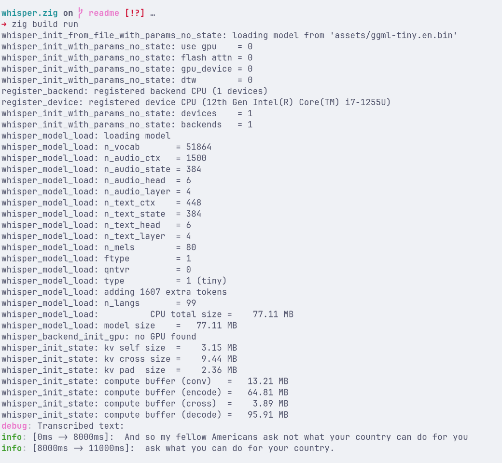

# whisper.zig

**whisper.zig** is an idiomatic Zig wrapper around [whisper.cpp](https://github.com/ggerganov/whisper.cpp). It simplifies running Whisper models in Zig and lays the foundation for bindings to other languages (such as Python and JavaScript) via FFI.

## Status

Currently in early development. The API is in active development and subject to change. The goal is to provide a clean, ergonomic, and safe public API to process audio files (WAV, MP3) and streaming inputs.

## Requirements

- Zig `0.16.0`
- A Whisper GGML model (e.g., `ggml-tiny.en.bin` from [Hugging Face](https://huggingface.co/ggerganov/whisper.cpp))

## Example

**Transcribing a WAV file:**

```zig
const std = @import("std");
const whisper = @import("root.zig");

pub fn main(init: std.process.Init) !void {
    const io = init.io;
    const allocator = init.gpa;

    // 1. Configure and load the model
    var params = whisper.Context.defaultParams();
    params.use_gpu = false;
    params.flash_attn = false;

    var context = try whisper.Context.initFromFile(
        "assets/ggml-tiny.en.bin",
        params,
    );
    defer context.deinit();

    // 2. Load audio samples (16kHz mono)
    const samples = try whisper.get_wav_file_samples(io, allocator, "assets/jfk.wav");
    defer allocator.free(samples);

    // 3. Transcribe
    try context.transcribe(samples, .{ .language = "en" });

    // 4. Retrieve segments
    std.log.debug("Transcribed text:", .{});
    for (0..context.segmentCount()) |i| {
        const seg = context.getSegment(i);
        std.log.info("[{d}ms -> {d}ms]: {s}", .{ seg.startMs(), seg.endMs(), seg.text });
    }
}
```

**Output Example:**



# whisper.zig

**whisper.zig** is an idiomatic Zig wrapper around [whisper.cpp](https://github.com/ggerganov/whisper.cpp). It simplifies running Whisper models in Zig and lays the foundation for bindings to other languages (such as Python and JavaScript) via FFI.

## Status

Currently in early development. The API is in active development and subject to change. The goal is to provide a clean, ergonomic, and safe public API to process audio files (WAV, MP3) and streaming inputs.

## Requirements

- Zig `0.16.0` (or latest `master`)
- A Whisper GGML model (e.g., `ggml-tiny.en.bin` from [Hugging Face](https://huggingface.co/ggerganov/whisper.cpp))

## Example

**Transcribing a WAV file:**

```zig
const std = @import("std");
const whisper = @import("root.zig");

pub fn main(init: std.process.Init) !void {
    const io = init.io;
    const allocator = init.gpa;

    // 1. Configure and load the model
    var params = whisper.Context.defaultParams();
    params.use_gpu = false;
    params.flash_attn = false;

    var context = try whisper.Context.initFromFile(
        "assets/ggml-tiny.en.bin",
        params,
    );
    defer context.deinit();

    // 2. Load audio samples (16kHz mono)
    const samples = try whisper.get_wav_file_samples(io, allocator, "assets/jfk.wav");
    defer allocator.free(samples);

    // 3. Transcribe
    try context.transcribe(samples, .{ .language = "en" });

    // 4. Retrieve segments
    std.log.debug("Transcribed text:", .{});
    for (0..context.segmentCount()) |i| {
        const seg = context.getSegment(i);
        std.log.info("[{d}ms -> {d}ms]: {s}", .{ seg.startMs(), seg.endMs(), seg.text });
    }
}
```

**Output Example:**


## Roadmap

- [ ] Support audio files longer than 30 seconds
- [ ] MP3 audio support
- [ ] GPU Acceleration
- [ ] Real-time streaming callbacks 
- [ ] Word-level timestamps
- [ ] Language bindings / FFI wrappers (Python, Node.js/JavaScript)
